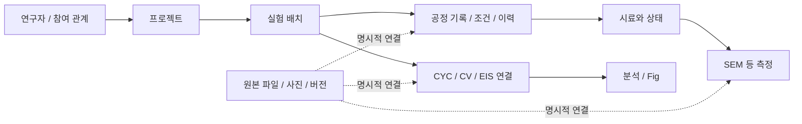

# Battery Data Portal

배터리 실험의 **프로젝트·배치·공정 조건·사진·측정 데이터·Fig**를 연결하는 연구 기록 포탈입니다.


파일을 분석하는 도구에서 출발해, 지금은 **“어떤 소재를 어떤 조건으로 가공했고, 어느 시료에서 어떤 결과가 나왔는가”**를 확인하는 실험 관리 도구로 확장하고 있습니다. CYC·CV·EIS 분석과 전극 계산도 같은 포탈에서 사용합니다.

> **코드와 소개의 기준** · 2026-10-22 문서 정리 기준, GitHub `main`의 실행 코드는 **v0.3.13**이고 최신 로컬 개발본은 **v0.3.20 Unreleased**입니다. 아래의 실험 관리·SEM 비교·Codex 도우미는 최신 로컬 개발본 기준이며, 현재 `main`을 내려받는 것만으로 제공되지 않습니다. 이번 반영은 문서 정리이며 미반영 소스의 배포나 릴리스가 아닙니다.

[주요 기능](#주요-기능) · [빠른 시작](#빠른-시작) · [현재 포탈 안내](docs/PORTAL_GUIDE.md) · [실행·저장 구조](docs/RUNNING.md) · [변경 이력](CHANGELOG.md)

## 어떤 일을 할 수 있나요?

| 작업 | 포탈에서 확인하는 내용 | 제공 기준 |
|---|---|---|
| 실험 관리 | 연구자별 프로젝트, 실험 배치, 참여 연구자, 날짜별 목록 | 최신 로컬 개발본 |
| 공정 기록 | 믹싱 작동·홀딩, 니딩 정·역방향, Pulverization, 체질, 롤밀, 롤프레싱 | 최신 로컬 개발본 |
| 사진·원본 연결 | 공정 사진, SEM 측정·시료 상태, 파일 버전과 연결 근거 | 최신 로컬 개발본 |
| 한눈에 비교 | CYC·SEM 갤러리, 개별 확대와 전체 비교, 토크 기록 조회 | 최신 로컬 개발본 |
| 전기화학 분석 | CYC 성능·전압 프로파일·dQ/dV, CV, EIS Nyquist·Bode·DRT | 저장소 코드 |
| 전극 계산·Fig | 질량·두께·조성 기반 계산, 그래프 편집·저장, CYC 비교 PPT 내보내기 | 저장소 코드 |
| 연구 도우미 | 허용된 실험·사진의 로컬 조회, 별도 동의 후 일반 AI 질문 | 최신 로컬 개발본·연결 설정 필요 |

“최신 로컬 개발본”은 이 프로젝트에서 구현·확인한 범위를 뜻합니다. 공개 서비스의 제공 상태나 모든 환경에서의 동작을 보장하는 표시는 아닙니다.

## 주요 기능

### 1. 연구자 → 프로젝트 → 실험 배치

연구자와 프로젝트를 바꾸며 실험 목록을 좁혀 봅니다. 최신 개발본에서는 새 배치 이름을 입력한 날짜·소재·조성비·배치량·선택 공정으로 자동 생성합니다. 프로젝트 생성·삭제와 선택 실험의 프로젝트 이동을 제공하며, 이동은 실험 ID나 연결 파일을 새로 만드는 작업이 아닙니다.

참여 연구자와 저장 계정의 소유권은 별개입니다. 전체 조회 설정이 있더라도 다른 연구자의 수정·삭제 권한까지 생기지는 않습니다.

### 2. 메모 속 조건을 공정 항목으로

최신 개발본은 믹싱의 작동·홀딩 시간과 사이클, 니딩의 정방향·역방향 시간과 사이클을 따로 기록합니다. 롤밀은 **rpm 한 칸**, 온도와 두 간격을 사용합니다. Pulverization, 체질, 롤프레싱 조건도 구분합니다.

확인하지 못한 조건은 빈칸으로 남깁니다. 파일명이나 총시간만 보고 반복 횟수를 만들거나, 다른 실험의 조건을 기본값처럼 복사하지 않습니다. 원문 메모·이전 기록은 근거로 보존합니다.

### 3. 원본과 결과를 연결해서 보기

CYC 셀 데이터와 SEM은 작은 카드로 비교하고 필요한 항목만 확대합니다. SEM 사진은 측정 대상 시료 상태와 파일 버전으로 연결하며, 같은 날짜나 조건이라는 이유로 동일 제조 배치라고 단정하지 않습니다. 토크 기록은 실제 관측값과 원본을 함께 확인합니다.

### 4. CYC·CV·EIS와 Fig

저장소 코드에서도 파일 업로드·검토, CYC 성능 및 충전·방전 곡선, 원시 전압–용량 데이터가 있는 경우의 dQ/dV, CV와 EIS 그래프를 제공합니다. EIS DRT는 재구성 오차와 수치 진단을 표시하지만 피크의 물리·화학적 의미를 자동 확정하지 않습니다.

질량·C-rate·로딩은 확인된 기준과 단위로 계산합니다. 기준이 없으면 측정 전류 또는 미확인 상태를 보여주며 임의의 1C·활물질 질량을 만들지 않습니다.

### 5. 포탈 안의 도우미

최신 개발본에서는 “연구자 A의 9월 실험 보여줘”와 같은 요청을 기존 권한 안에서 **로컬 조회**합니다. 사진·SEM도 허용된 파일만 불러옵니다. 이는 연구자료 전체를 외부 AI에 보내 검색하는 방식이 아닙니다.

외부 AI 질문은 별도 연결 설정과 매 전송 동의가 필요합니다. 같은 담당자로 페이지를 이동하면 대화와 다음 질문 초안을 유지하지만, 새로고침·담당자 변경 후까지 영구 보관하는 채팅 저장소는 아닙니다.

## 실험 기록은 어떻게 연결되나요?



최신 로컬 실험 관리의 개념도입니다. 모든 단계가 자동 생성되는 것은 아니며, **확인된 연결만 저장**합니다. 기존 Cell·Dataset·Fig 구조는 별도로 유지하고 명시적으로 연결합니다.

## 빠른 시작

### GitHub 코드를 처음 실행할 때

Windows PowerShell, Git, Python 3.12가 필요합니다. 아래는 **새 개발 폴더·새 로컬 데이터**용이며 사용 중인 연구 DB 위에서 실행하는 절차가 아닙니다. Node.js는 포탈 실행에는 필요 없고 JavaScript 검사에 사용합니다.

```powershell
git clone https://github.com/JONGHO01/battery-data-portal.git
cd battery-data-portal
py -3.12 -m venv .venv
& .\.venv\Scripts\python.exe -m pip install -r requirements.txt
```

계정 로그인형 저장소 코드를 loopback 주소로 실행합니다. 실제 비밀값을 출력하거나 파일에 적지 않고, 현재 PowerShell 세션에서만 개발용 서명값을 만듭니다.

```powershell
$env:APP_ENV = 'local'
$env:DATABASE_URL = ''
$env:STORAGE_BACKEND = 'local'
$env:REQUIRE_DURABLE_STORAGE = 'false'
$env:ALLOW_LEGACY_USER_HEADER = 'false'
$env:BOOTSTRAP_ADMIN_ID = ' '
$env:JWT_SECRET = (New-Guid).Guid + (New-Guid).Guid
& .\.venv\Scripts\python.exe -m uvicorn python_backend:app --host 127.0.0.1 --port 4174
```

브라우저에서 [http://localhost:4174/](http://localhost:4174/)를 열고 새 계정을 등록합니다. 이 절차는 기존 연구자료·관리자 계정·연구자 선택 모드를 복원하지 않습니다. 종료는 실행 창에서 `Ctrl+C`입니다. 포트가 사용 중이면 기존 프로세스를 종료하지 말고 먼저 확인하세요.

### 이미 구성한 연구실 포탈을 사용할 때

기존 DB·파일 저장소·실행 옵션을 유지하는 전용 런처를 사용합니다. **새 clone에 기존 `.env`나 DB를 덮어 복사하지 마세요.** 최신 실험 관리 스키마 준비와 연구자 선택 모드는 별도 작업입니다. 상세한 차이는 [실행 안내](docs/RUNNING.md)를 참고하세요.

## 어떻게 구동되나요?

```text
브라우저: HTML / CSS / JavaScript
                 │ 같은 서버의 HTTP API
                 ▼
             Python FastAPI
                 ├─ 로컬: SQLite + 로컬 파일 저장소
                 └─ 호스팅: PostgreSQL + 비공개 객체 저장소
```

HTML 파일만 여는 정적 사이트나 GitHub Pages 서비스가 아닙니다. Python 서버가 인증·권한 확인, 파일 파싱, 저장·조회와 분석 요청을 처리하고 화면 파일도 제공합니다. `npm start` 역시 Python 서버를 호출하는 보조 명령이지 별도의 Node 백엔드가 아닙니다.

Neon·Backblaze B2·Render는 호스팅 구성에 사용할 수 있습니다. **GitHub push, 호스팅 배포, 실제 서비스 상태는 각각 다릅니다.** 업로드했다고 서비스 연결까지 확인된 것은 아닙니다.

## 데이터 처리 원칙과 제한

- 연구 원본·DB·계정·실제 사진은 이 저장소의 배포 자료가 아닙니다.
- 원본, 파싱 결과, 분석, Fig와 출처를 구분합니다. 정규화·편집 결과를 원본 측정값처럼 설명하지 않습니다.
- 로컬 **이름 선택은 비밀번호 인증이 아닙니다.** 공유 PC용 모드를 인터넷에 노출하지 않습니다.
- 호스팅에는 영속 DB·비공개 저장소·서비스 비밀값 설정이 필요합니다. 운영 DB를 로컬 초기화나 시험에 사용하지 않습니다.
- 전체 자료 자동 공유, 자동 실험 추정, 외부 AI 학습용 전송을 기본 기능으로 제공하지 않습니다.

## 문서와 개발

| 문서 | 내용 |
|---|---|
| [현재 포탈 안내](docs/PORTAL_GUIDE.md) | 최신 실험 관리·공정·사진·도우미의 사용 흐름과 경계 |
| [실행·저장 구조](docs/RUNNING.md) | 새 개발 환경과 기존 연구실 환경의 차이, 상태 확인, 문제 해결 |
| [B2 + PostgreSQL 저장](docs/B2_LOCAL_ARCHIVE.md) | 호스팅용 메타데이터·파일·장기 백업의 분리 |
| [EIS DRT](docs/EIS_DRT.md) | 수치 계산·피크·진단의 의미와 제한 |
| [데이터 관리](docs/DATA_WORKSPACE.md) | 기존 Dataset 분류·전처리·로컬 파일 검색 |
| [변경 이력](CHANGELOG.md) | 버전별 변경 기록 |

폴더별 역할과 검사 명령은 [실행·개발 안내](docs/RUNNING.md#개발과-검증)에 있습니다. 기존 [v0.15 설계](docs/ARCHITECTURE_V0.15.md)는 초기 Dataset 계층에 대한 역사 문서이며 최신 실험 관리 전체를 설명하지는 않습니다.

## 버전 이력

| 기준 | 버전 | 핵심 내용 |
|---|---|---|
| 최신 로컬 개발본 | v0.3.20 Unreleased | 롤밀 단일 rpm 입력; 실험 관리·공정 조건·사진 비교·도우미 흐름 포함 |
| 로컬 개발 이력 | v0.3.14–v0.3.19 Unreleased | 프로젝트 이동, 압축 WRD·SEM 비교, 대화·초안 유지, 자연어 날짜 조회 |
| 저장소 실행 코드 | v0.3.13 · 2026-10-12 | DRT L-curve·피크 기준 정정, 독립 KK 수치 진단 |
| 이전 저장소 이력 | v0.3.9–v0.3.12 | CYC 프로파일·C-rate·전극 정보와 DRT 보완 |

문서만 정리한 이번 변경은 앱 버전을 올리지 않습니다. 최신 개발 소스의 GitHub 반영은 별도 회귀 검증이 남아 있으며, 완료 전까지 `main`을 v0.3.20으로 표시하지 않습니다.

### 소개 구성 참고

[jkf87의 저장소 목록](https://github.com/jkf87?tab=repositories) 중 [KIPRIS Performance Verifier](https://github.com/jkf87/kipris-performance-verifier), [인사 통계 관리 도구](https://github.com/jkf87/personnel-stats-app), [voice-memo-doc](https://github.com/jkf87/voice-memo-doc)의 기능·실행·데이터 처리·검증 분리 방식을 참고했습니다. 설명과 구성도는 이 포탈의 실제 구조를 기준으로 새로 작성했습니다.
